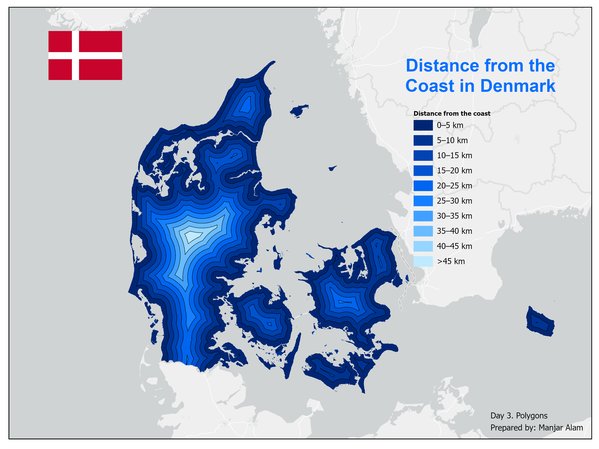

# Day 3. Beyond the Shore: Mapping Coastal Distance

## Overview

- **Theme:** Polygons
- **Project type:** Coastal proximity analysis and thematic cartography
- **Study area:** Denmark

This project explores the spatial relationship between Denmark's coastline and its inland areas through coastal distance analysis. Using Euclidean distance modelling, the map illustrates how distance from the nearest coastline varies across the country. The continuous distance surface is classified into multiple distance zones and represented through nested blue-to-white bands, highlighting the gradual transition from coastal areas to the interior landscape.

## Data & Tools
**Data Sources**

- [Natural Earth-Land](https://www.naturalearthdata.com/downloads/10m-physical-vectors/10m-land/)
- [Natural Earth-Coastline](https://www.naturalearthdata.com/downloads/10m-physical-vectors/10m-land/)
- [DIVA-GIS](https://diva-gis.org/data.html)

**Tools Used**

* ArcGIS Pro
* Spatial Analyst Extension
* Euclidean Distance, Extract by Mask, Reclassify and Raster to Polygon

## Key takeaways

- The map represents the spatial variation in distance from Denmark's coastline.
- Distance-based classification reveals distinct coastal proximity zones across the landscape.
- Polygon-based representation transforms continuous distance measurements into interpretable thematic regions.
- The analysis demonstrates how spatial modelling and cartographic design can communicate coastal proximity.
