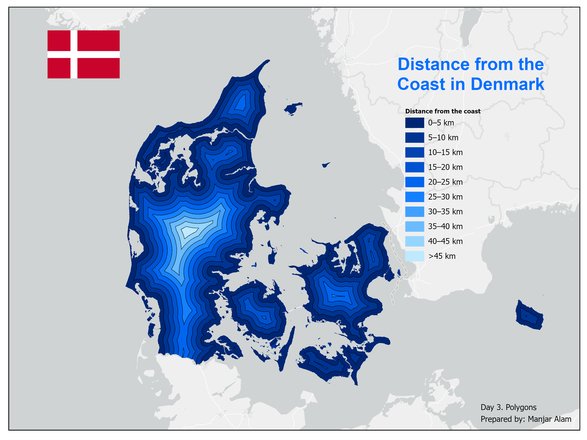

# Day 5.  The Visible Himalayas

## Overview

- **Theme:** Sight
- **Project type:** 3D terrain visualization and elevation mapping
- **Study area:** Uttarakhand, India

This project presents a three-dimensional view of Uttarakhand's Himalayan landscape using digital elevation data and hillshade. By combining elevation colours with terrain shading, the map highlights the region's mountain ranges, valleys and variations in topography. River networks provide additional geographical context to the terrain.

## Data & Tools
**Data Sources**

- [SRTM DEM](https://www.opendem.info/download_srtm.html)
- [HydroRIVERS](https://www.hydrosheds.org/products/hydrorivers)
- [State Boundary](https://diva-gis.org/data.html)

**Tools Used**

* ArcMap, ArcGIS Pro
* DEM processing and hillshade generation
* 3D terrain visualization

## Key takeaways

- The 3D visualization highlights the complex Himalayan relief of Uttarakhand.
- Combining DEM and hillshade enhances the perception of elevation, ridges and valleys.
- River networks provide geographical context to the mountainous landscape.
- The map demonstrates how elevation data can transform a conventional terrain map into an immersive visual representation.
