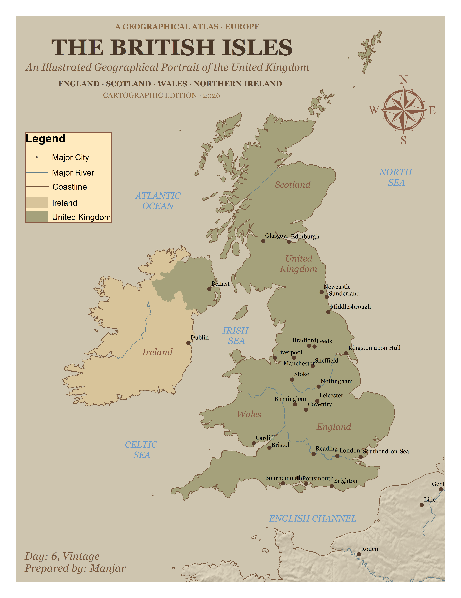

# Day 6. The British Isles: An Illustrated Geographical Portrait

## Overview

- **Theme:** Vintage
- **Project type:** Vintage-style geographical and thematic mapping
- **Study area:** United Kingdom and Ireland

This project presents the British Isles through a vintage atlas-inspired cartographic design. The map combines country boundaries, coastlines, major rivers, and selected cities to illustrate the geographical characteristics of the region. Using muted earthy tones, parchment-style backgrounds, serif typography, and traditional cartographic elements, the map recreates the visual appearance of an antique geographical atlas.

## Data & Tools
**Data Sources**

- [Natural Earth-Cultural Data](https://www.naturalearthdata.com/downloads/)
- [Natural Earth-Physical Data](https://www.naturalearthdata.com/downloads/)

**Tools Used**

* ArcGIS Desktop (ArcMap 10.4)
* Natural Earth vector datasets
* Cartographic design and layout techniques

## Key takeaways

- The map illustrates the geographical relationship between the United Kingdom and Ireland through country boundaries, coastlines, rivers, and major cities.
- Vintage-inspired symbology, muted colour palettes, and traditional typography recreate the appearance of historical atlas maps.
- The project demonstrates how cartographic styling and visual hierarchy can transform contemporary geographical datasets into an antique-inspired map presentation.
