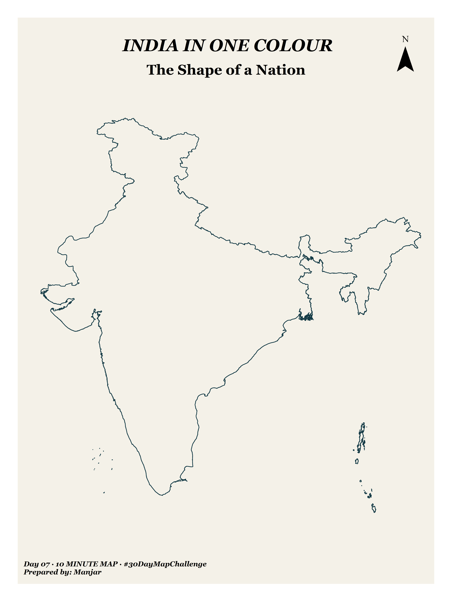

# Day 7.  India in One Colour

## Overview

- **Theme:** 10 Minute Map
- **Project type:** Country-level thematic cartography
- **Study area:** India

India is a land of remarkable geographical, cultural and regional diversity. This map presents the outline of India through a distinctive turquoise shade, offering a simple visual representation of a nation shape. Created for the 10 Minute Map theme, the map celebrates India's distinctive geographical form through a focused cartographic design.

## Data & Tools
**Data Sources**

- [DIVA-GIS](https://diva-gis.org/data.html)

**Tools Used**

* ArcGIS Pro

## Key takeaways

- A single-colour design can communicate a country's geographical outline clearly.
- Minimalist cartographic styling keeps the focus on the study area.
- The map demonstrates how a simple spatial dataset can produce an effective visual result within the 10-minute mapping theme.
