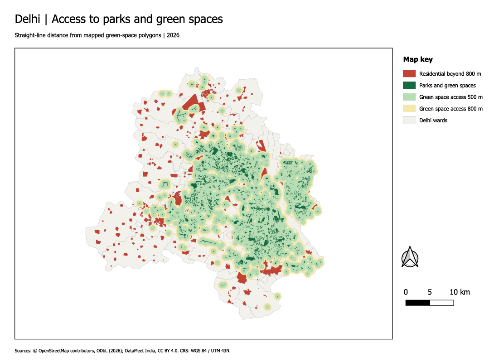

# Day 10. Prompting-From Words to Maps

## Overview

- **Theme:** Prompting Only
- **Project type:** AI-assisted geospatial analysis and urban planning
- **Study area:** Delhi, India

This project explores how prompt engineering can be used to perform geospatial analysis through an AI-powered GIS agent. Using natural language instructions, the TerraLab AI Agent is guided to analyse the spatial distribution of urban parks and green spaces in Delhi.

The analysis focuses on identifying residential areas within 500 m and 800 m of existing parks and highlighting neighbourhoods with potentially limited access to green spaces. The objective is to demonstrate how carefully designed prompts can translate spatial problems into meaningful GIS workflows and map outputs.

## Data & Tools
**Data Sources**
**Tools Used**

- Data Input: Provide the required spatial datasets, including urban parks and residential areas.

- Prompt Engineering: Develop clear instructions describing the spatial problem, analysis requirements and expected map output.

- AI-Assisted Analysis: Use the TerraLab AI Agent to perform proximity and buffer-based spatial analysis.

- Accessibility Assessment: Examine residential areas within 500 m and 800 m of existing parks.

- Map Generation: Visualize parks, accessibility zones and potentially underserved residential areas.

## Key takeaways

- This exercise demonstrates how effective prompting can bridge the gap between natural language and geospatial problem-solving, making GIS analysis more accessible through AI-powered tools.
