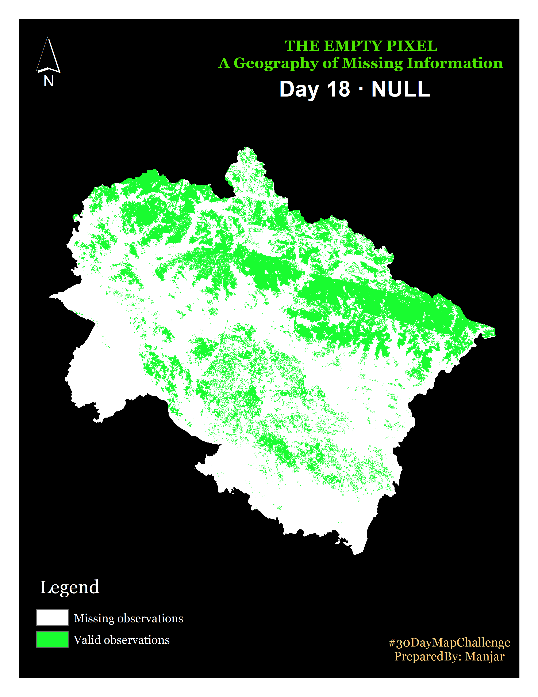

# Day 18. THE EMPTY PIXEL: A Geography of Missing Information

## Overview

- **Theme:** NULL
- **Project type:** Mapping Missing and Obscured Satellite Observations
- **Study area:** Uttarakhand, India

Not everything that satellites capture contains meaningful information. Cloud cover, cloud shadows, defective pixels and missing observations create spatial gaps in Earth observation datasets. This project explores the geography of NULL by identifying and visualizing pixels where reliable surface observations are unavailable or obscured.

## Data & Tools
**Data Sources**

- Sentinel-2: Copernicus Programme, European Space Agency.
- Administrative Boundaries: India state boundary dataset.
- Processing Platform: Google Earth Engine.

**Tools Used**

* QGIS, ArcGIS Pro
* Google Earth Engine [GEE Notebook](#Link)

## Key takeaways

- By mapping missing and obscured satellite observations, this project highlights the importance of data availability, observation quality and spatial uncertainty in remote sensing.
