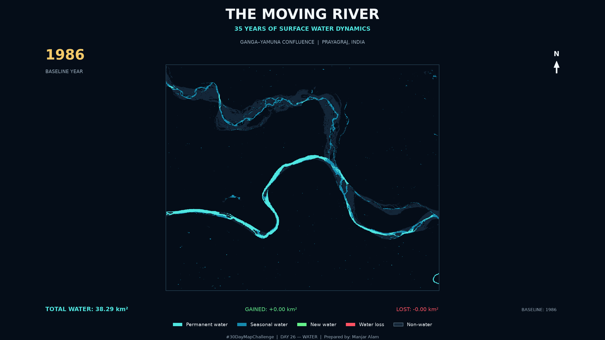

# Day 26. Water: The Moving River - 35 Years of Surface Water Dynamics, Prayagraj, India

## Overview

- **Theme:** Water
- **Project type:** Multi-temporal raster analysis and thematic cartography
- **Study area:** Ganga-Yamuna confluence, Prayagraj, Uttar Pradesh, India

This project explores the changing surface water patterns around the Ganga-Yamuna confluence at Prayagraj, India, over a 35-year period (1986–2020). Titled **The Moving River**, the map visualizes annual surface water classifications and highlights areas where water presence has changed over time.

Using the **JRC Global Surface Water Yearly History** dataset, annual raster observations were processed to distinguish permanent water, seasonal water, and non-water areas. Year-to-year comparisons were used to identify locations classified as water gain or water loss between consecutive years.

The visualization combines a dark cartographic background with contrasting cyan, blue, green, and red tones to distinguish water classes and highlight temporal changes. A cinematic animation presents the evolving water landscape from 1986 to 2020.

## Data & Tools

**Data Sources**

- [JRC Global Surface Water](https://global-surface-water.appspot.com/)
- [Google Earth Engine Data Catalog - JRC Global Surface Water](https://developers.google.com/earth-engine/datasets/catalog/JRC_GSW1_4_YearlyHistory)

**Tools Used**

- Python (Rasterio, NumPy, Matplotlib, Pandas, Pillow, ImageIO)
- GeoTIFF annual water classification rasters (1986–2020)
- [Python Notebook](#Link)

## Methodology

- Processed 35 annual water classification rasters covering 1986–2020.
- Identified valid pixels and classified them into non-water, seasonal water, and permanent water.
- Calculated annual surface water extent from valid raster observations.
- Compared consecutive years to identify water gain and water loss.
- Generated annual visualization frames and combined them into a time-series animation.
- Exported annual water statistics for further analysis.

**Water Classification**

| Class value | Description |
|---|---|
| 0 | No data |
| 1 | Not water |
| 2 | Seasonal water |
| 3 | Permanent water |

## Key Takeaways

- The project illustrates the temporal dynamics of surface water around the Ganga–Yamuna confluence over 35 years.
- Annual water classifications provide a way to explore the distribution of seasonal and permanent water.
- Year-to-year comparisons highlight locations where water presence changed between consecutive annual observations.
- The animation transforms a long-term raster dataset into an engaging visual representation of surface water dynamics.
- The analysis demonstrates how multi-temporal satellite-derived datasets can support the monitoring and interpretation of changing water landscapes.

## Outputs

- Annual water classification maps (1986-2020).
- Cinematic surface water change animation (GIF).
- MP4 animation (where video export is available).
- Annual surface water statistics in CSV format.

## Limitations

- The analysis represents annual water classifications and does not capture every short-term hydrological event.
- Water gain and loss are calculated using pixels valid in both consecutive years.
- Changes in classified water extent should not be interpreted as definitive evidence of river-channel migration without additional hydrological and geomorphological analysis.
- Results depend on the spatial resolution, classification, and observation coverage of the source dataset.

---