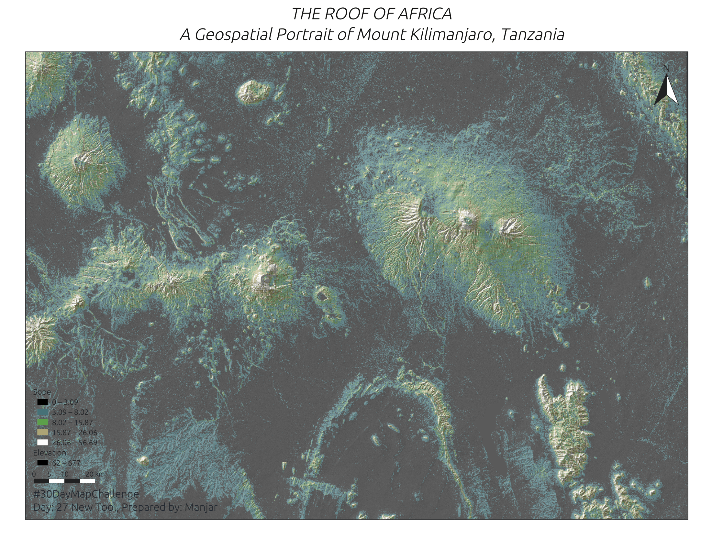

# Day 27. THE ROOF OF AFRICA: A Geospatial Portrait of Mount Kilimanjaro, Tanzania

## Overview

- **Theme:** New Tool: RustGIS
- **Project type:** Digital terrain analysis and thematic cartography
- **Study area:** Mount Kilimanjaro, Tanzania, East Africa

This project explores the dramatic topography of Mount Kilimanjaro, Africa's highest mountain, using RustGIS, a modern geospatial platform developed by Qiusheng Wu. The objective was to investigate the mountain's elevation, terrain characteristics and slope patterns through digital elevation model (DEM) processing and terrain visualization.

A 30-metre Shuttle Radar Topography Mission (SRTM) Digital Elevation Model was used as the primary elevation dataset. Six DEM tiles covering the study area were merged into a continuous raster and projected to WGS 84 / UTM Zone 37S (EPSG:32737) for terrain analysis.

## Data & Tools

**Data Sources**

- [SRTM 30 m Digital Elevation Model](https://www.earthdata.nasa.gov/data/instruments/srtm)
- [Global DEM Portal](https://globaldemportal.github.io/)

**Tools Used**

- RustGIS by (Qiusheng Wu)
- DEM Mosaicking and Reprojection
- Hillshade and Slope Analysis
- Raster Visualization and Thematic Cartography

## Key Takeaways

- The map provides a detailed topographic representation of Mount Kilimanjaro, Africa's highest mountain.
- DEM-based hillshade enhances the visualization of terrain relief and volcanic landforms.
- Slope analysis highlights variations in terrain steepness across the mountain and its surrounding landscape.
- The project demonstrates the application of RustGIS for raster processing, digital terrain analysis and geospatial visualization.
- The workflow highlights the importance of combining elevation data and terrain derivatives for understanding complex mountainous landscapes.
