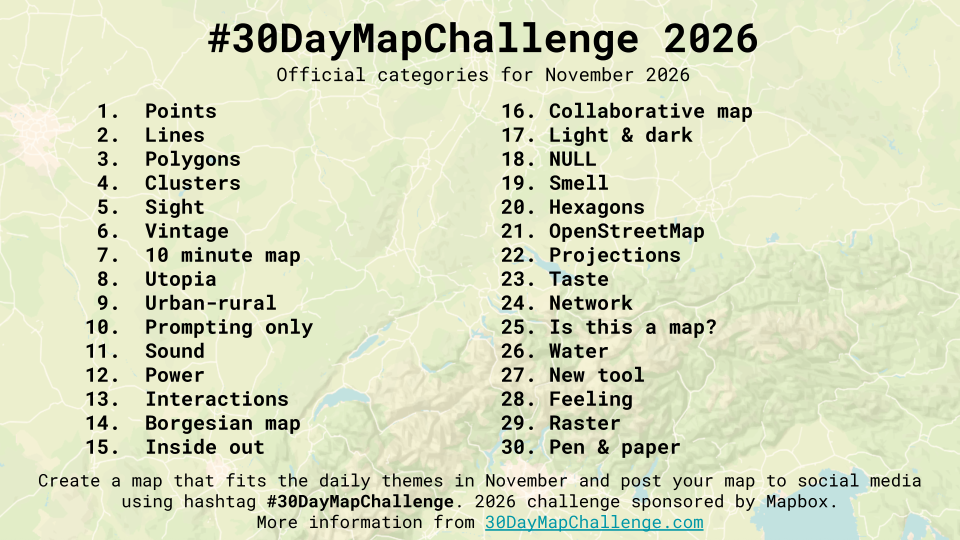
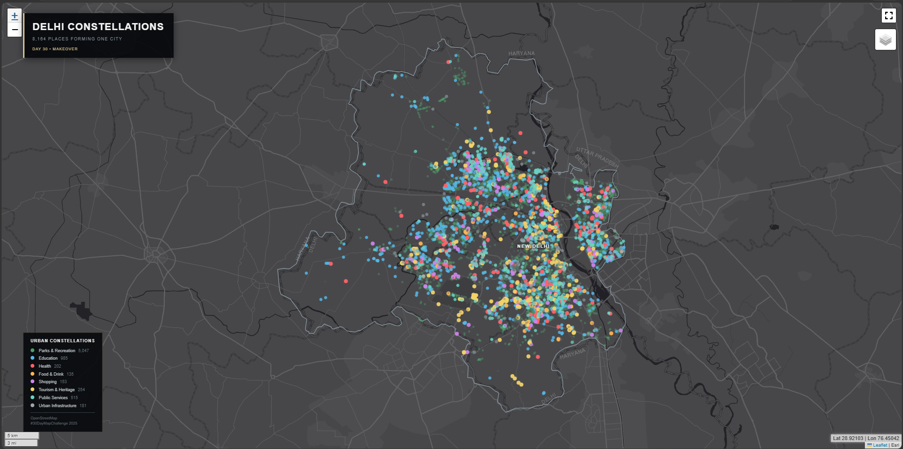

---
hide:
  - toc
  - navigation
---

 
# 30-Day Map Challenge

A collection of 30 days of geospatial exploration, combining GIS, Remote Sensing, Python, spatial analysis, interactive mapping, and cartographic design. Each map explores a different geographical theme, from urban networks and land use to vegetation, climate, terrain, hydrology, and global connectivity.

Explore the map gallery below. Select **View Project** to learn about the objective, data sources, methods, and tools used for each map, then open the interactive HTML visualization to zoom, pan, and explore the map features.
<!-- Replace the path below with the relative path to your image in your MkDocs project docs folder -->

  

---

<!-- Day 01 -->

**[Day 1. Points](30_day_map/maps_md/day-01.md)**

A Spatial Portrait of Delhi.

`Urban GIS` `POI Mapping` `Python`

[View Project](30_day_map/maps_md/day-01.md){ .md-button }

<!-- Day 02 

**[Day 02 — Delhi Road Network](30_day_map/maps_md/day-02.md)**

Visualize Delhi's road network and explore its spatial structure and connectivity.

`Transportation` `Network Mapping` `GIS`

[View Project →](30_day_map/maps_md/day-02.md){ .md-button }

-->

---

## Explore the Maps

Each project page provides a summary of the map, its methods and tools, and links to the interactive HTML output and source code where available. The gallery is a showcase of geospatial learning, experimentation, and cartographic design.
